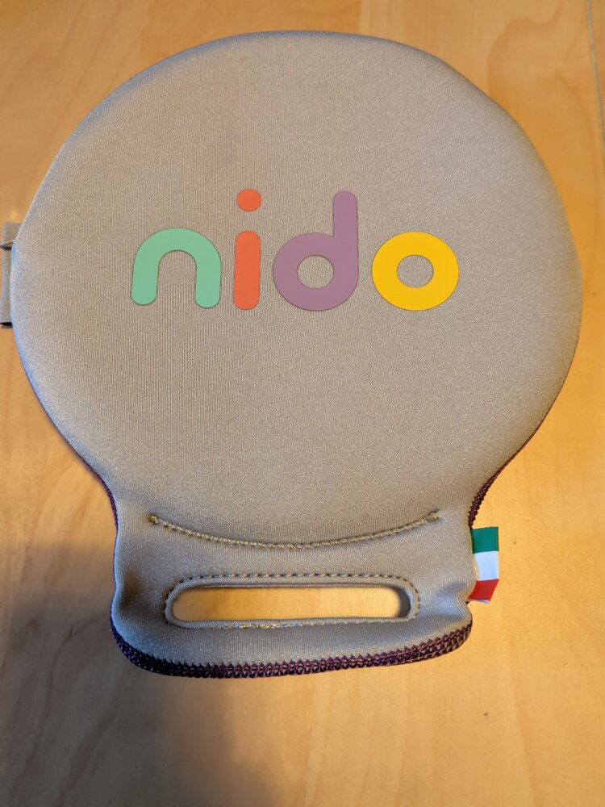

<div align="center">

# 🐣 Nido Locale

**L'app alternativa, libera e senza cloud per il cuscino anti-abbandono NIDO di Tucano**




*Il cuscino anti-abbandono NIDO di Tucano, con cui questa app è compatibile*

</div>

---

> [!CAUTION]
> ## ⛔ LEGGERE PRIMA DI USARE: NESSUNA GARANZIA, NESSUNA RESPONSABILITÀ
>
> **Questo è un progetto personale, sperimentale e amatoriale.** È stato scritto per uso
> privato dell'autore e viene pubblicato solo a titolo informativo e di studio.
>
> - **NON è un dispositivo di sicurezza certificato** e **NON è conforme** ad alcuna norma sui
>   dispositivi anti-abbandono (in Italia: art. 172 del Codice della Strada e D.M. 2 ottobre 2018 n. 122).
>   Usarla al posto dell'app ufficiale **può far venire meno la conformità** del tuo sistema
>   anti-abbandono ai requisiti di legge.
> - **PUÒ NON FUNZIONARE.** Bug, aggiornamenti di Android, ottimizzazioni della batteria del
>   produttore del telefono, Bluetooth spento o disturbato, telefono scarico, silenzioso o
>   lontano, firmware diverso del tappetino, e infinite altre cause possono impedire
>   all'allarme di suonare **senza alcun preavviso**.
> - **L'AUTORE NON SI ASSUME ALCUNA RESPONSABILITÀ**, di nessun tipo, per qualsiasi danno a
>   persone, animali o cose derivante dall'uso, dal mancato funzionamento o dal funzionamento
>   errato di questo software, **compresi lesioni o morte di bambini o di chiunque altro**.
>   L'autore non risponde in alcun modo della sicurezza dei figli altrui.
> - Il software è fornito **"COSÌ COM'È", SENZA GARANZIE DI ALCUN TIPO**, esplicite o
>   implicite, comprese quelle di funzionamento, affidabilità o idoneità a uno scopo
>   particolare, nei limiti massimi consentiti dalla legge (vedi le sezioni 15 e 16 della
>   [licenza GPL-3.0](LICENSE)).
> - **Nessun software sostituisce l'attenzione dell'adulto.** La responsabilità della
>   sorveglianza del bambino resta **sempre e soltanto di chi lo trasporta**.
>
> **Se scarichi, compili, installi o usi questa app, accetti di farlo interamente a tuo
> rischio e sotto la tua esclusiva responsabilità.** Se non accetti queste condizioni, non
> usarla e continua a usare l'app ufficiale del produttore.

> [!WARNING]
> **Progetto non ufficiale.** Non è affiliato, approvato o supportato da **Tucano** né dal
> produttore del dispositivo **NIDO**. I nomi "NIDO" e "Tucano" sono marchi dei rispettivi
> titolari e sono usati solo per indicare con quale dispositivo l'app è compatibile.
> Il protocollo è stato ricostruito a scopo di interoperabilità e potrebbe essere
> incompleto o cambiare con nuovi firmware.

---

## ✨ Perché esiste

L'app ufficiale del NIDO chiede **registrazione e account** su un portale online per fare una cosa
che in realtà avviene tutta in locale: parlare via Bluetooth con il cuscino e farti suonare il
telefono se ti allontani con il bambino a bordo.

**Nido Locale** fa solo questo, e lo fa sul tuo telefono:

| | App ufficiale | 🐣 Nido Locale |
|---|:---:|:---:|
| 👤 Account / registrazione | richiesto | **nessuno** |
| ☁️ Dati inviati a server | sì | **nessuno** (niente permesso INTERNET) |
| 📍 Accesso alla posizione GPS | sì | **no** |
| 🔔 Allarme bambino a bordo | ✅ | ✅ |
| 🔋 Avviso batteria cuscino | ✅ | ✅ |
| 🧾 Codice sorgente aperto | ❌ | ✅ GPL-3.0 |

## 🚀 Funzionalità

- 🔗 **Connessione diretta** via Bluetooth LE al cuscino `Nido_XXXX`, con riconnessione automatica
- 🚨 **Allarme** (suoneria sveglia al volume massimo, anche in silenzioso, 📳 vibrazione e schermata
  rossa a tutto schermo anche a telefono bloccato) se, **con il bambino a bordo**:
  - 🚶 ti allontani e la connessione si perde
  - 📡 il cuscino smette di trasmettere per 15 s
  - 📴 il Bluetooth viene spento
  - 🔄 Android riavvia l'app e il cuscino non risponde entro 30 s
- 🧘 **Antirimbalzo**: il seggiolino risulta vuoto solo dopo ~4 s di letture "vuoto", così i
  movimenti del bambino non ingannano il sistema
- 🔕 **Stop automatico** quando torni vicino all'auto, oppure con il pulsante *"Ho il bambino"*
- 🔋 **Avviso batteria** del cuscino sotto il 20%
- 🧪 **Prova allarme** per verificare in qualsiasi momento che suoni davvero
- 📱 **Riparte da sola** dopo il riavvio del telefono
- ⚠️ **Avvertenza di sicurezza** da accettare a ogni apertura dell'app

## 📲 Installazione

1. ⬇️ Scarica l'APK dalle [**Release**](../../releases) (oppure compilalo, vedi sotto)
2. 🔓 Consenti l'installazione da fonti sconosciute e installalo
3. ❌ **Chiudi o disinstalla l'app ufficiale**: il cuscino accetta **un solo telefono connesso** alla volta
4. ✅ Accetta l'avvertenza e concedi i permessi
5. 🟠 Tocca uno per uno gli **avvisi arancioni** nell'app (ottimizzazione batteria, allarme a
   schermo intero su Android 14+): sono importanti perché l'allarme funzioni in background
6. 🔍 *Cerca tappetino* → tocca il tuo `Nido_XXXX` → 🧪 *Prova allarme*

> [!TIP]
> Alcuni produttori (Xiaomi, Huawei, Samsung, OnePlus…) chiudono le app in background in modo
> aggressivo. Consulta [dontkillmyapp.com](https://dontkillmyapp.com) per il tuo modello e
> **collauda** l'app: con un peso sul cuscino allontanati dall'auto col telefono bloccato in tasca
> e verifica che l'allarme suoni.

**Requisiti:** Android 8.0 (API 26) o superiore, con Bluetooth LE.

## 🔬 Come funziona

```
  ┌──────────────┐   Bluetooth LE, ogni ~2 s    ┌───────────────────┐
  │ Cuscino NIDO │ ───── "1,2900\n" ─────────▶ │    Nido Locale    │
  │  (Nido_XXXX) │   seduto , batteria mV       │ servizio in primo │
  └──────────────┘                              │       piano       │
                                                └─────────┬─────────┘
                                                          │
                     connessione persa + bambino seduto   ▼
                                                     ALLARME !!!
```

- 📡 Servizio BLE `49535343-fe7d-4ae5-8fa9-9fafd205e455` (UART trasparente Microchip)
- 📨 Dati in notifica/indicazione su `49535343-1e4d-4bd9-ba61-23c647249616`
- 🔤 Formato ASCII: `"<seduto>,<batteria_mV>\n"` → `1` = bambino a bordo, `0` = vuoto
- 🔓 Nessuna autenticazione e nessun comando da inviare al cuscino

Tutti i dettagli in 📄 [docs/PROTOCOLLO.md](docs/PROTOCOLLO.md).

## 🛠️ Compilazione

Serve JDK 17–21 e l'Android SDK (platform 34).

```bash
./gradlew assembleRelease testDebugUnitTest
# 📦 APK: app/build/outputs/apk/release/app-release.apk
```

## 🤝 Contribuire

Segnalazioni e pull request sono benvenute! In particolare sono utili:
- 🧪 resoconti di **collaudo** con modello del telefono e versione di Android
- 📋 log di nRF Connect da cuscini con **firmware diversi**

## 📜 Licenza

Distribuito con licenza [**GPL-3.0**](LICENSE), **senza alcuna garanzia**. Rileggi le
**avvertenze in cima a questa pagina** prima dell'uso. 💛
